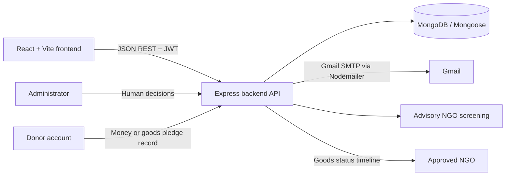

# Architecture

## System overview

The application has no active payment processing or external event automation. Money donations are pledge records only. Payment gateway support is future work.

## Main modules

- **Identity:** role-aware registration, bcrypt password hashes, JWTs, profile edits, account status checks, and atomic single-use OTP password reset.
- **NGO onboarding:** registration metadata and HTTPS document references, advisory completeness/duplicate flags, admin decision, and status display.
- **Requests:** approved NGOs submit requests in `pending`; admin decisions determine publication. Published requests are filtered to approved NGOs and future deadlines.
- **Donations:** individuals record money pledges; company/organization accounts record itemized goods pledges. A request can be reserved by one pledge at a time.
- **Tracking:** the owning, approved NGO records goods pickup, collection, receipt, completion, cancellation or dispute milestones. Each update records actor and time.
- **Administration:** dashboard statistics, NGO/request review queues and user suspension/reactivation.
- **Email:** backend sends notifications through Nodemailer and Gmail SMTP. Delivery state and duplicate prevention are tracked in MongoDB.

## Data model

Four primary Mongoose models persist the application:

- `User`: identity, role, account status, password hash, token version, profile and reset-token state.
- `NGO`: registration details, document references, verification decision and advisory screening data.
- `DonationRequest`: NGO need, target, requested goods, deadline and moderation state.
- `Donation`: donor, NGO, optional request, money/goods pledge, pickup details and tracking history.

ObjectId relationships are checked by API routes; MongoDB does not provide relational foreign keys. Historical donation schemas may still contain fields saved by an earlier payment-enabled version. Current code does not invoke those providers or mark current pledges as paid.

## Security boundaries

- Password hashes and reset OTP state are excluded from JSON serialization. Six-digit OTPs are SHA-256 hashed, expire in 10 minutes, allow at most five incorrect attempts, and are consumed with a conditional atomic password update.
- JWTs expire and include a per-user token version. Suspended accounts are denied; admin status changes invalidate old tokens, including upon reactivation.
- Backend routes enforce role and record ownership; frontend guards are only navigation aids.
- Zod request validation, Helmet, CORS allowlisting, JSON body-size limits, authentication and API rate limits are enabled.
- Public request and NGO queries select public fields only. Donation details are limited to the donor, owning NGO and admin.
- Money pledge records use `pledged` status and do not increment funds received or provide payment instructions.
- Screening scores are advisory. Admins must review authoritative evidence; scores do not establish legal authenticity.
- NGO documents and receipt references are HTTPS URLs, not an implemented secure upload/storage mechanism.

Production deployment still needs private object storage, audit logging, durable notification retries, shared rate limiting for multiple instances, monitoring, backups, privacy/legal review and a tested operations process.

## Email delivery

`emailService.js` sends mail through Nodemailer configured with Gmail SMTP and server-only `EMAIL_USER`, `EMAIL_APP_PASSWORD`, and `EMAIL_FROM` variables. A unique event key is recorded in MongoDB to avoid duplicate sends. Regular notification delivery is best-effort, not a durable outbox or retry system. Failed password-reset email delivery clears the newly issued OTP.

## NGO screening

Screening checks missing registration details/documents and possible duplicate registration data. It is an explainable triage aid only. Admin approval is not a guarantee of legal authenticity and must be based on appropriate human review.

## Payment boundary

The project records declared money pledges but does not process, verify, receive or settle payments. A payment gateway is documented as a future enhancement only; no payment credentials are needed to run the current application.
