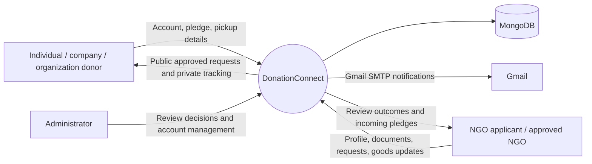
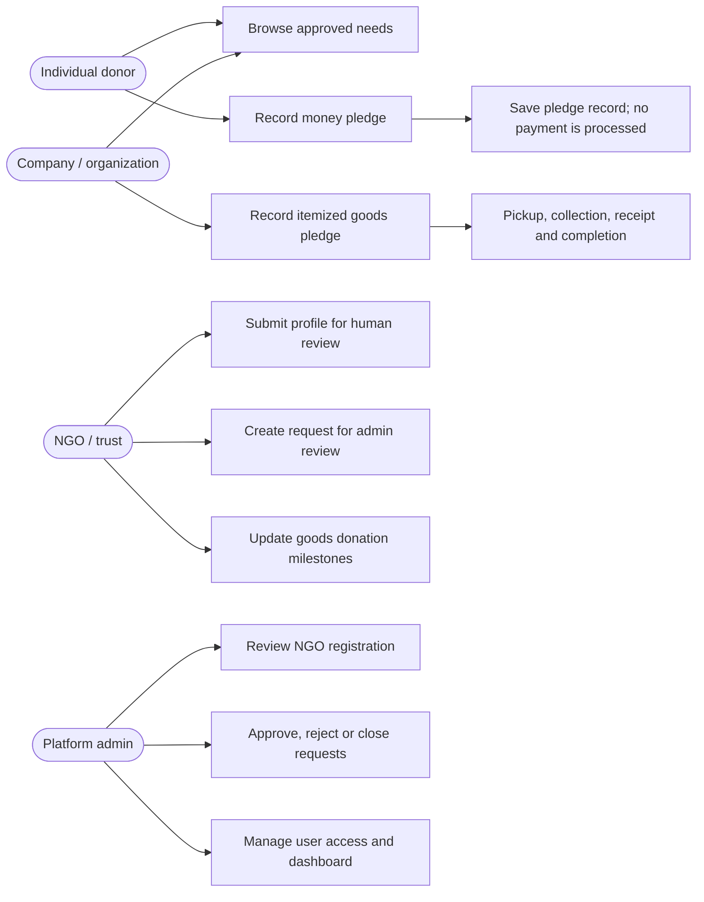
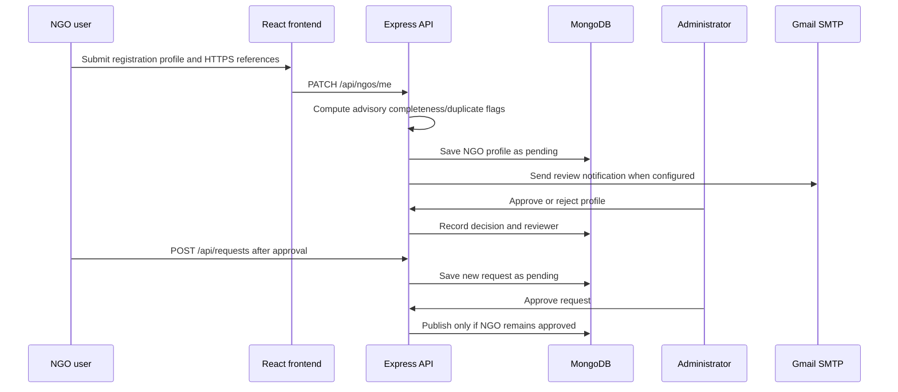
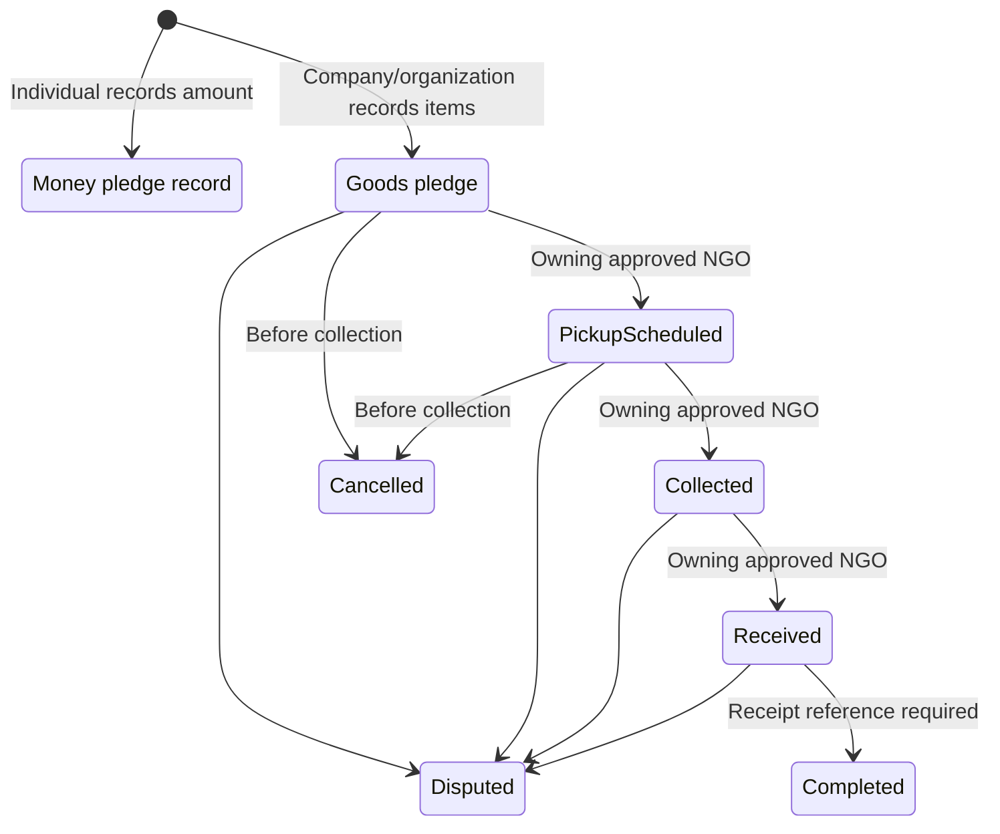
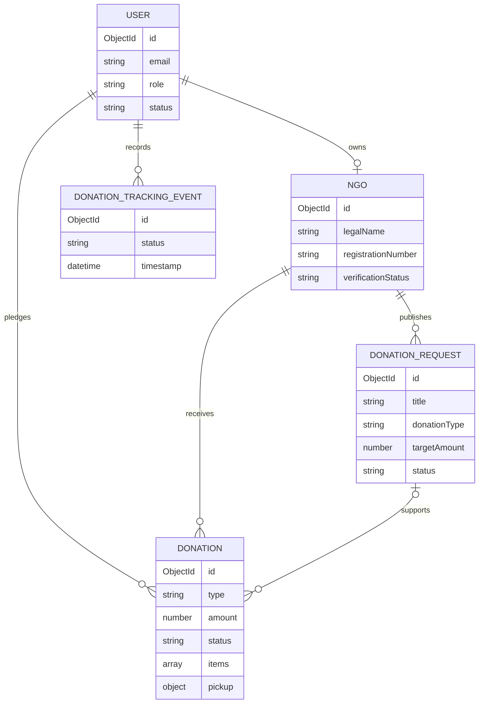

# DonationConnect Diagrams

## System context

## Use cases

## NGO review and request publication

## Donation states

Money pledges remain records only; there are no payment or receipt transitions for money.

## Data model

Tracking events, donation goods and pickup information are embedded subdocuments in the current Mongoose models.
